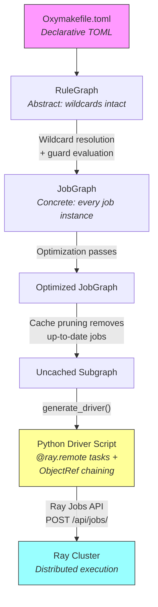
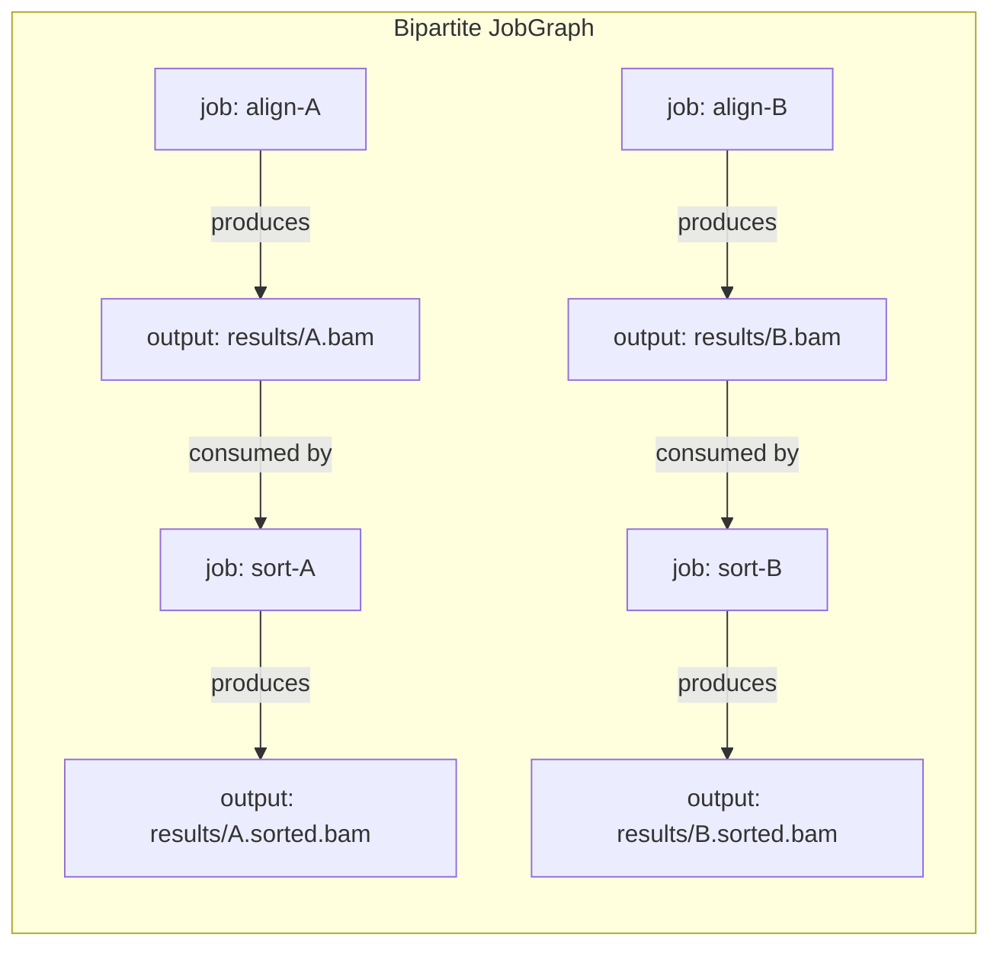
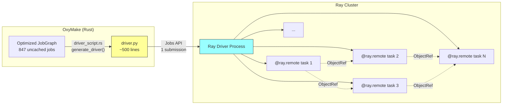
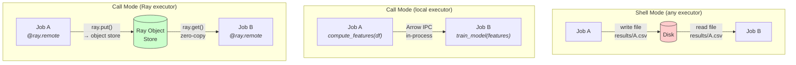
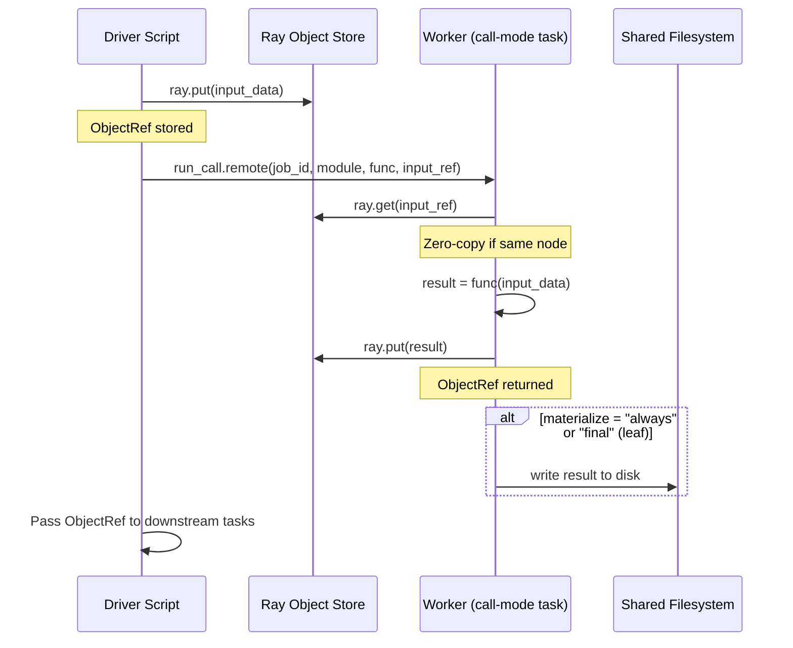
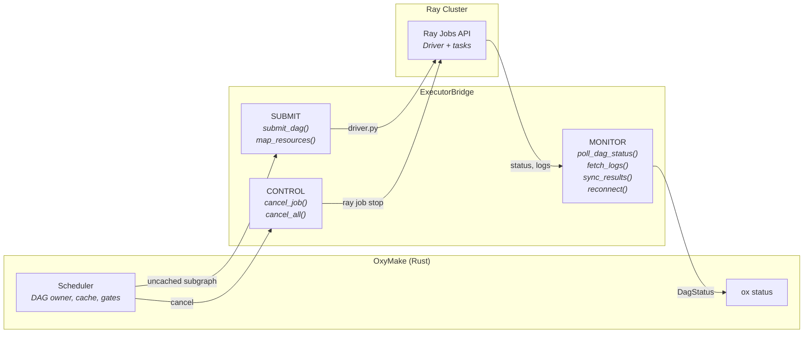

# OxyMake × Ray Deep Dive

OxyMake and Ray solve different halves of the distributed compute problem.
OxyMake owns the **what**: which jobs to run, in what order, and what can be
skipped. Ray owns the **where**: which machine, which GPU, how many cores.
This page explains how the two systems fit together.

## The Three Graphs Meet Ray

Before any executor sees a job, OxyMake transforms the user's declarations
through three graph representations. Understanding this pipeline is essential
for understanding what Ray actually receives.

### Graph Transformation Pipeline



### RuleGraph — What You Wrote

The RuleGraph is the abstract view: each rule is a node, wildcards are
unresolved. A single `features` rule represents ALL feature instances.

```
data ──→ features ──→ call ──→ annotate
```

### JobGraph — What Will Execute

After wildcard resolution, each concrete job is a separate node. With 3
cohorts and 4 windows, a single `features` rule becomes 12 concrete
jobs. The JobGraph is **bipartite** — job nodes and output nodes alternate:



### Optimization Passes

Before any executor sees the graph, OxyMake runs optimization passes:

| Pass | Effect |
|------|--------|
| **Cache pruning** | Marks up-to-date jobs as "skip" |
| **Task fusion** | Merges sequential `call`-mode jobs into one |
| **Materialization elimination** | Removes unnecessary disk I/O |
| **Critical path analysis** | Annotates the longest chain for priority |

These passes run internally. `ox plan` reports the jobs that remain after
pruning, in the standard plan format -- for a large, mostly-cached pipeline:

```
Plan: 12 rules, 847 jobs, 1203 source files
```

Only the **uncached subgraph** is sent to Ray.


## Driver Python interpreter

If the head node's default `python3` cannot import Ray, select the Python
executable from the environment where Ray is installed:

```bash
ox run results/output.parquet --executor ray --ray-python /opt/ray/bin/python
```

`--ray-python` defaults to `python3`. It selects the native DAG driver
interpreter and the call-mode wrapper interpreter, including wrappers launched
inside the DAG. The path is resolved on the Ray hosts, so call wrappers need it
on every node that runs them. Quote paths containing spaces when invoking `ox`;
OxyMake also quotes the executable and script paths in the submitted command.
This flag accepts one executable, without arguments. It configures the host,
with no workflow-level setting or environment-variable override. Ordinary
shell, script and inline `run` tasks keep their declared interpreters.

## Resource admission

Each shell, script, inline `run`, and `call` task receives its checked CPU,
GPU, memory and custom resource request. For example,
`resources = {cpu = 1, memory = "4GiB", metal = 1}` reserves one logical CPU,
4 GiB of logical memory and one `metal` token. A cluster advertising one
`metal` token serializes tasks requesting that token across concurrent DAG
runs. Ray memory is **logical admission** against the memory declared by its
nodes; it is not an enforced resident-set-size ceiling. The single DAG driver
reserves **zero** logical CPUs, no memory and no task tokens; it only
orchestrates, though it still consumes real CPU and memory.

Before submitting the driver, OxyMake reads `/api/v0/nodes?detail=1` from the
Ray dashboard and checks every active task against each live node's **total**
capacity. One node must satisfy the complete request simultaneously. A task
requiring CPU=2 and metal=1 cannot use nodes `{CPU: 8}` and `{CPU: 1, metal: 1}`
by adding their capacities. Omitted CPU defaults to 1. Capacity already in use
still counts: a busy but capable node queues the task normally.

An impossible request fails before any recipe is submitted, with the rule,
requested resources, observed live node capacities and this escape hatch:

```sh
ox run --executor ray --ray-allow-pending --follow
```

Use `--ray-allow-pending` when a future node will supply the missing resources.
It skips node inspection but preserves resource value and name validation.
Sites that always permit pending Ray work can set
`ray_allow_pending = true` in the selected `[profile.NAME]`; an explicit CLI
flag takes precedence over a profile value.
Without it, inspection has a fixed **10-second deadline**, including the response
body. Connection errors, timeouts and malformed/unknown payloads have distinct
diagnostics. Partial or truncated node lists are rejected. Ray's dashboard
must expose the detailed State API. This is a pre-submission snapshot; OxyMake
does not monitor later topology changes or manage the autoscaler.

An empty live-node list is not evidence that a request is impossible: the
cluster may be scaling from zero or waiting for workers. OxyMake warns once and
submits in that case. When live nodes are visible and no single node provides
the complete request, submission still fails so misspelled or impossible
requests do not remain pending forever.

## Token-authenticated dashboards

Set `RAY_AUTH_MODE=token` when the Ray dashboard requires token
authentication. OxyMake then loads the client token using Ray's precedence:

1. `RAY_AUTH_TOKEN`
2. the file named by `RAY_AUTH_TOKEN_PATH`
3. `~/.ray/auth_token`

Leading and trailing whitespace in environment and file tokens is ignored. If
none of those sources provides a token, OxyMake stops before making a dashboard
request. The bearer token is used for submission, status, logs, cancellation,
and the pre-submission node inspection. It is not written to the generated
driver, run metadata, reports, or logs.

A bearer token sent over plain HTTP is readable on the wire; put any Ray
dashboard reachable beyond loopback behind TLS.

Native DAG submissions pass `RAY_AUTH_MODE=token` to the driver, but never the
token itself. The driver runs on the cluster and must be able to load its own
token using Ray's cluster-local configuration. If a dashboard answers 401,
OxyMake reports the observed mode and the token sources it consulted without
printing any part of the token.

The `token` value is case-insensitive. When `RAY_AUTH_MODE` is unset or has any
other value, OxyMake performs no token lookup and sends no authorization
header.

Custom names with surrounding whitespace are rejected. Names colliding with
Ray built-ins or reserved prefixes are also rejected; see the
[resource reference](../reference/format.md#resources). `time_min` is a SLURM
key, not a Ray time limit.

For native DAG submission, `mem`, `memory`, `mem_mb` and `mem_gb` are normalized
to whole bytes and passed as Ray task `memory` reservations. The pre-submission
check compares each request independently with one live node's total `memory`;
it does not sum sibling tasks. Ray queues and serializes simultaneously ready
tasks when their combined reservations exceed currently available capacity.
An explicit zero-byte declaration remains present in the generated task
options, while a task with no memory declaration emits no memory option.

This reservation currently applies only to tasks in the generated native DAG.
The older per-job Jobs API path and the array-emulation path do not request Ray
memory. On the per-job path, `OXYMAKE_MEMORY_LIMIT_BYTES` remains a runtime
environment **hint** for the process; it is neither Ray admission nor hard RSS
containment. Array submissions likewise keep their existing behavior. Do not
rely on either path for memory reservation.

A submission acknowledgment means the driver was accepted. `--follow` reports
its terminal failure, `ox status` refreshes failed driver state even without a
results file, and `ox logs JOB` retrieves driver logs. `ox cancel` stops the
shared Ray driver when any of its tasks is selected, cancelling the whole DAG,
including queued tasks. Interrupting `--follow` also stops its driver and exits
with code `130`. The message confirms the driver stopped, or reports a failed
cancellation; use `ox status` to check remote work and `ox cancel` to retry.
Three consecutive poll rounds with errors end follow with
exit code `1`, naming the dashboard and last error. An error-free round resets
the counter. See [remote follow](../reference/commands.md#ox-run) for details.

### Running the live scheduling witnesses

The Rust test suite includes ignored tests that require an isolated real Ray
cluster and a directory mounted at the same absolute path on the driver and
workers. They check single-CPU completion, two drivers sharing one `metal`
token with a no-token negative control, busy-node queueing, and cancellation
before capacity frees. They do not start or reconfigure a cluster.

```sh
export OXYMAKE_RAY_LIVE_ADDRESS=http://127.0.0.1:8265
export OXYMAKE_RAY_LIVE_DIR=/shared/oxymake-tests
# Cluster with exactly one live node and one CPU:
cargo test -p ox-exec-ray --test live_dag_resources single_cpu -- --ignored
# Separate cluster with exactly one live node, two CPUs and metal=1:
cargo test -p ox-exec-ray --test live_dag_resources two_drivers -- --ignored
cargo test -p ox-exec-ray --test live_dag_resources busy_node -- --ignored
# Separate cluster with exactly one live node and at least two CPUs:
cargo test -p ox-exec-ray --test live_dag_resources two_tasks_serialize_when_their_memory_sum_exceeds_one_node -- --ignored
# Against a token-mode head, with a client-side token source configured and a
# cluster-local token available to the submitted driver:
RAY_AUTH_MODE=token cargo test -p ox-exec-ray --test live_dag_resources token_mode_dashboard_and_driver_authenticate -- --ignored
```

Ignored tests are **NOT RUN**, not passing scheduling evidence. HTTP contract
tests exercise submission and cancellation requests but cannot prove Ray's
actual scheduling behavior.

## Ray Job Packaging

### Why One Ray Job, Not N

OxyMake could submit each task as a separate Ray job. Instead, it generates
a **single Python driver script** that encodes the entire uncached DAG as
`@ray.remote` tasks with ObjectRef dependency chaining.



**Benefits of single-job packaging:**

| Benefit | Why |
|---------|-----|
| **Fire-and-forget** | Submit once, Ray handles all scheduling |
| **ObjectRef chaining** | Upstream outputs become implicit dependencies |
| **Ray parallelism** | Ray's internal scheduler optimizes task placement |
| **Cascading cancel** | `ray job stop` cascades to all tasks |
| **Dashboard visibility** | One job with N tasks and a colored progress bar |
| **Reduced API load** | One HTTP submission instead of hundreds |

### Generated Driver Structure

The Rust code in `ox-exec-ray/src/driver_script.rs` generates Python that
looks like this:

```python
import ray
import subprocess
import time
import json

ray.init()

@ray.remote
def run_shell(job_id, command, work_dir, *deps):
    """Run a shell command. *deps are ObjectRefs — Ray waits for them."""
    result = subprocess.run(command, shell=True, cwd=work_dir, ...)
    if result.returncode != 0:
        raise RuntimeError(f"Job {job_id} failed")
    return result.returncode

@ray.remote
def run_call(job_id, module, func_name, *deps):
    """Run a call-mode function with object store integration."""
    # ray.get() inputs from object store
    # invoke function
    # ray.put() outputs back to object store
    ...

# --- DAG encoded as ObjectRef chain ---
# Topological order, upstream refs passed as implicit dependencies

ref_0 = run_shell.options(num_cpus=8).remote(
    "align-A", "bwa mem ...", "/project"
)
ref_1 = run_shell.options(num_cpus=2).remote(
    "sort-A", "samtools sort ...", "/project",
    ref_0  # ← dependency: Ray won't start until ref_0 completes
)
ref_2 = run_shell.options(num_cpus=8).remote(
    "align-B", "bwa mem ...", "/project"
)
ref_3 = run_call.options(num_cpus=4, num_gpus=1).remote(
    "train", "pipeline.model", "train",
    ref_1, ref_2  # ← depends on both sort-A and align-B
)

# --- Collect results ---
results = {}
for ref, job_id in [(ref_0, "align-A"), (ref_1, "sort-A"), ...]:
    try:
        ray.get(ref)
        results[job_id] = {"status": "completed"}
    except Exception as e:
        results[job_id] = {"status": "failed", "error": str(e)}

# Write manifest for ox status
with open("results.json", "w") as f:
    json.dump(results, f)
```

The Ray dashboard shows this as **1 job** with a task-level progress bar:

```
Ray Dashboard → Jobs → raysubmit_abc123
  Tasks: ████████░░░░░░  127/847 (15%)
  Running: 16  |  Pending: 704  |  Completed: 127
```


### Per-task records

The driver's `results.json` is written only once every task has finished and
holds only status and exit code; a killed driver leaves none. Each task
therefore also writes its own record, `.oxymake/runs/<run-id>/tasks/<job>.json`,
as soon as its command exits, successfully or not (a temporary file is written
and then renamed, so a reader never sees a partial record):

```json
{"job_id": "align-A", "status": "completed", "exit_code": 0,
 "started_at": 1792954442.37, "ended_at": 1792954442.53, "wall_time_ms": 150,
 "cpu_time_ms": 129, "peak_rss_bytes": 54951936,
 "node_id": "fcc1d6c6…", "hostname": "worker-3"}
```

The task reaps its command's process with `os.wait4`, so `cpu_time_ms` (user +
system) and `peak_rss_bytes` cover that process and the descendants it waited
for; background or daemonised work escapes them. `RUSAGE_CHILDREN` is not used
because Ray reuses worker processes and that counter accumulates across tasks.

`ox run --follow` reads a job's record on each poll and settles the job when
it appears; without `--follow`, `ox status` reads all records of the run. The
first process to read a record moves the job to its terminal state, keeps the
task's own start and end, writes its history row (`ox history --run-id ID
--json`: `wall_time_ms`, `peak_mem_mb`, `cpu_time_ms`, `node`) and emits one
`job_completed` or `job_failed` event to the run's event log. The event's
`endpoint` and `submission_id` are the dashboard address and the driver's
submission ID recorded when the DAG was submitted. `node` is the
task's host name; the Ray node ID stays in the record. Usage reaches history
for completed jobs only. Events appended by `ox status` list no `outputs`,
because it does not load the workflow. A job without a record (its task never
ran) still takes its state from `results.json` or the driver. The record format
is internal and may change; read usage through `ox history` or the event log.

Under `ox run --follow`, a completed task also enters the cache when its record
is read: its outputs are hashed and recorded under the same computation key a
local run would use, and their blobs are stored in `--cache-remote` when it is
set. A resubmission, including one after a killed driver, then skips the units
that completed. `ox status` does not record cache entries: it does not load the
workflow, and recomputing a key from the current Oxymakefile could attach the
outputs to a rule edited since submission. A run submitted without `--follow`
therefore re-executes its completed units on the next `ox run`.

## Call Mode and the Ray Object Store

This is where OxyMake and Ray truly complement each other. In `call` mode,
OxyMake manages I/O outside the function — and on the Ray executor, that
I/O goes through Ray's distributed object store instead of disk.

### Data Flow: Shell vs Call vs Ray-Call



| Mode | Data between stages | Disk I/O | Best for |
|------|-------------------|----------|----------|
| **Shell** (any executor) | Files on disk | Always | CLI tools, legacy scripts |
| **Call** (local executor) | Arrow IPC, in-process | Optional (materialization policy) | Single-node data pipelines |
| **Call** (Ray executor) | `ray.put()`/`ray.get()`, object store | Optional (materialization policy) | Distributed data pipelines |

### How Ray Call Mode Works

When a `call`-mode job runs on the Ray executor, OxyMake generates a wrapper
script (via `call_mode.rs`) that integrates with the object store:



### Materialization Policies on Ray

OxyMake's materialization policies map directly to Ray behavior:

| Policy | Object Store | Disk Write | Use Case |
|--------|-------------|------------|----------|
| `always` | Yes | Yes | Debugging, external tools need files |
| `auto` | Yes | Only if downstream needs a file | Default — let OxyMake decide |
| `never` | Yes (evicted after consumers finish) | No | Pure intermediates, save disk |
| `final` | Yes | Only for DAG leaves | Pipeline outputs to disk, intermediates in memory |

**Example rule with materialization:**

```toml
[rule.compute_features]
input = [{ path = "data/{sample}.parquet", format = "parquet" }]
output = [{ path = "features/{sample}.parquet", format = "parquet", materialize = "auto" }]
call = "pipeline.features:compute_features"
lang = "python"
resources = { cpu = 4, mem_gb = 8 }
```

With `materialize = "auto"` on the Ray executor, the features DataFrame
lives in the Ray object store. If the next rule is also `call`-mode on Ray,
data passes through the object store with zero disk I/O. If a downstream
rule is `shell`-mode and needs a file path, OxyMake automatically
materializes to disk.


## The Bridge (ADR-008)

The `ExecutorBridge` trait formalizes the separation between OxyMake's
scheduler and remote executors. It defines three communication directions:



### Separation of Concerns

| Concern | OxyMake (Scheduler) | Ray (Executor) |
|---------|--------------------|----|
| **DAG construction** | Parses Oxymakefile, resolves wildcards | -- |
| **Cache checking** | Content-addressable (blake3) | -- |
| **Optimization** | Cache pruning, task fusion, critical path | -- |
| **Scheduling order** | Topological sort, priority, gates | -- |
| **Task placement** | -- | Which node, which GPU |
| **Resource allocation** | -- | CPU, memory, GPU scheduling |
| **Autoscaling** | -- | Scale workers up/down |
| **Object store** | -- | Zero-copy data passing |
| **Fault tolerance** | Retry strategy (OxyMake-managed) | Worker failure detection |

### State Synchronization

After submission, OxyMake stays connected via the bridge:

1. **Submit**: `submit_dag()` generates the driver script, submits to Ray
   Jobs API, writes `meta.json` to `.oxymake/runs/{run_id}/`
2. **Poll**: `poll_dag_status()` queries Ray for per-task status, returns
   `DagStatus` with job-level completion info
3. **Sync**: `sync_results()` writes job results (exit codes, durations,
   peak memory) back to OxyMake's state database
4. **Reconnect**: After an OxyMake crash, `reconnect()` reads `meta.json`
   and reconstructs a handle to the still-running Ray job

The `meta.json` contract:

```json
{
  "executor": "ray",
  "version": 1,
  "submitted_at": "2025-04-01T12:00:00Z",
  "connection": {
    "ray_address": "http://127.0.0.1:8265",
    "ray_job_id": "raysubmit_abc123"
  },
  "run_id": "run-550e8400-e29b-41d4-a716-446655440000",
  "total_jobs": 847,
  "active_jobs": 847,
  "skipped_jobs": 102582
}
```

An explicit status selector resolves this exact local ID and its bound driver;
an address override changes only the endpoint. Failure to resolve that driver
does not fall back to enumerating unrelated Ray jobs.

### Resource Mapping

OxyMake resources map to Ray resources via `map_resources()`:

| OxyMake | Ray | Notes |
|---------|-----|-------|
| `cpu` / `cpus` | `num_cpus` | Exact to `0.0001` before Ray conversion |
| `mem` / `memory` | task `memory` (native DAG) | Whole bytes after parsing a byte count or binary-unit string |
| `mem_mb` / `mem_gb` | task `memory` (native DAG) | MiB / GiB converted to whole bytes |
| `gpu` / `gpus` | `num_gpus` | Fractional GPUs up to one (`gpu = 0.5`), or whole multi-GPU counts |
| any custom key / `custom:tpu` | Custom resource | Arbitrary case-sensitive Ray custom resources |

Ray's advantage: fractional GPUs (`num_gpus=0.5`) enable model serving
workloads where multiple inference tasks share a single GPU.

This table describes the checked mapper output and native DAG task options.
The per-job Jobs API and array-emulation limitations are described in
[Resource admission](#resource-admission).


## Philosophy: Complementary, Not Overlapping

OxyMake and Ray solve orthogonal problems:

| Dimension | OxyMake | Ray |
|-----------|---------|-----|
| **Core question** | What to run? | Where to run it? |
| **Key innovation** | Content-addressable cache | Distributed object store |
| **Configuration** | Declarative TOML | Python API / YAML |
| **DAG model** | Three-level (Rule → Job → Exec) | Flat task graph |
| **Cache** | blake3 content hashing | None (execution-only) |
| **Scheduling** | Topological + priorities + gates | Resource-based bin packing |
| **State** | Persistent (state.db, cache) | Ephemeral (cluster lifetime) |

### Why Not Snakemake + Ray or Airflow + Ray?

**Snakemake + Ray:** Snakemake's file-based cache uses timestamps, not content
hashes. It has no materialization policies, no call mode, and its Python DSL
prevents static analysis. Adding Ray to Snakemake gives you distributed
execution but not the optimization pipeline (task fusion, materialization
elimination) that makes the combination powerful.

**Airflow + Ray:** Airflow is an orchestrator that owns the DAG schedule.
Adding Ray as an executor gives you distributed compute, but Airflow's DAG
model is runtime-defined Python, not declarative TOML. You cannot inspect or
optimize an Airflow DAG before execution.

**OxyMake + Ray:** OxyMake's declarative format enables static analysis and
optimization passes *before* execution. Ray provides elastic compute and
zero-copy data passing *during* execution. Neither system steps on the
other's responsibilities.

```mermaid
flowchart LR
    subgraph "OxyMake Responsibilities"
        direction TB
        A1["Parse Oxymakefile.toml"]
        A2["Resolve wildcards"]
        A3["Check content-addressable cache"]
        A4["Optimize: fuse, prune, eliminate"]
        A5["Generate driver script"]
        A1 --> A2 --> A3 --> A4 --> A5
    end

    subgraph "Ray Responsibilities"
        direction TB
        B1["Receive driver script"]
        B2["Schedule tasks on workers"]
        B3["Manage object store"]
        B4["Autoscale cluster"]
        B5["Report task status"]
        B1 --> B2 --> B3 --> B4 --> B5
    end

    A5 -->|"Ray Jobs API"| B1
    B5 -->|"poll_dag_status()"| A5

    style A5 fill:#ff9,stroke:#333
    style B1 fill:#9ff,stroke:#333
```




## Quick Start

### 1. Start a Ray cluster

```bash
ray start --head
# Dashboard: http://127.0.0.1:8265
```

### 2. Configure OxyMake

```toml
# Oxymakefile.toml
[executor.ray]
dashboard_address = "http://127.0.0.1:8265"
```

### 3. Run your workflow on Ray

```bash
ox run --executor ray
```

OxyMake handles caching, DAG optimization, and driver generation. Ray
handles task placement, GPU scheduling, and data passing. Your workflow
file does not change.

### Shared filesystem requirement

The native Ray DAG driver is generated under the Oxymakefile's
`.oxymake/runs/` directory and submitted to Ray by its shell-quoted absolute
path, with symlinks resolved. For example, `-f <symlink>/Oxymakefile.toml`
submits the path under the real project directory. OxyMake needs write access
to the staging directory; staging failures report the affected path and the
underlying IO error. The Ray head and workers that execute the driver must
be able to see that OxyMake working directory through a shared filesystem. OxyMake does not upload the
driver with `runtime_env.working_dir`, because changing Ray's job working
directory would change how workflow rules resolve their relative inputs and
outputs. A remote head without that shared mount is not supported by this
executor.

### Output finalization

Shell, script and inline `run` tasks write directly to their declared final
paths. After a zero exit, Ray verifies every declared file exists, stages all
files to sibling `.oxytmp` paths, then renames them back, as the local executor
does. Each rename is atomic; the set of outputs is not a filesystem transaction.
A missing output fails the task with `OutputMissing`. A nonzero exit or missing
output removes declared files and engine scratch, unless `clean_outputs =
"never"` preserves the final files. With `never`, successful files are verified
and left in place without staging. Per-task records report finalization errors
as failures even when the command exited zero. Call-mode files that the wrapper materializes also participate; outputs
kept only in the object store have no file finalization.

This is post-execution finalization: a hard kill, preempted worker node or
stopped head during writing cannot run cleanup and can leave a partial final
file, as with local execution. Neither executor substitutes temporary paths
before running the command. File presence alone is not a successful cache entry:
cache identity uses the computation key, and a failed task must not be recorded
as a successful cached computation. Failed tasks remain eligible to run again.

### 4. Monitor execution

```bash
ox status                 # OxyMake's view (aggregated)
# or visit Ray Dashboard for task-level detail
```


## Further Reading

- [Executors](./executors.md) -- all available executors and configuration
- [Execution Modes](./execution-modes.md) -- shell, run, script, call
- [The Three Graphs](./three-graphs.md) -- RuleGraph, JobGraph, ExecGraph
- [Materialization Policy](./materialization.md) -- controlling disk I/O
- [Content-Addressable Cache](./cache.md) -- how cache keys work

## Run labels

Attach external identifiers with `ox run --executor ray --metadata external.id=123`.
Repeat `--metadata KEY=VALUE` for more labels. Labels are merged into the
submitted driver's metadata alongside `oxymake_run_id`, `oxymake_dag_driver`
and `oxymake_dag_total_jobs`. A multi-rule driver does not receive a fabricated
`oxymake_job_id` or `oxymake_rule`; standalone executor submissions retain
those internal fields. Internal fields always win during merging.

Labels also appear once in `run_started.metadata` and in `ox history --json`
run records, including fully cached runs that submit nothing to Ray. They do
not change computation cache keys. See the [flag reference](../reference/commands.md#ox-run)
for key/value limits and the reserved prefix.
