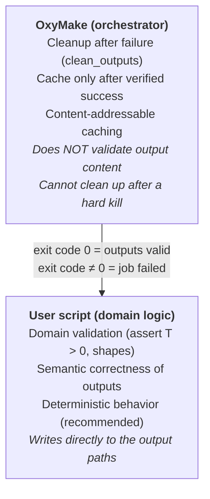

# Output Integrity: Responsibility Split

OxyMake and user scripts share a clear contract for output correctness.
OxyMake owns **failure cleanup and cache admission** (a failed job does not
leave outputs behind, and only a successful, verified job is cached). Scripts
own **domain validation** (the content is semantically correct). Neither side
can protect a file against a hard kill during writing; see
[Hard kills](#hard-kills).

## OxyMake guarantees

| Property | Mechanism |
|----------|-----------|
| **Cleanup after failure** | A job that exits non-zero, or exits 0 without producing every declared output, has its declared outputs removed according to `clean_outputs` (default `"always"`). See [Output cleanup](../book/src/reference/format.md#output-cleanup). |
| **Verification and staging after success** | After a zero exit OxyMake checks that every declared file output exists, then renames each to a sibling `.oxytmp` path and back. The renames run after the command has finished; the command itself writes to the final paths. |
| **Cache admission** | A job is recorded in the cache only after it succeeded and its outputs were verified. A failed job is never cached and runs again. |
| **Content-addressable cache** | Cache keys include a content hash of every input. If inputs haven't changed, cached outputs are reused without re-execution. |
| **No phantom re-runs** | Caching is based on content hashes, not timestamps. Operations like `git checkout` or `cp` that change mtime but not content do not trigger unnecessary rebuilds. |

If OxyMake's cleanup or caching mechanism has a bug, that is OxyMake's
responsibility to fix.

## Hard kills

OxyMake does not substitute temporary paths before running a command. A command
writes directly to its declared output paths, and the cleanup above runs only
when `ox` itself keeps running. A hard kill (SIGKILL, power loss, a preempted
node) during writing can therefore leave a partial file at a final output path.

- With the default `mtime+hash` and with `hash` validation, such a file is not
  a cache hit: the job was never recorded as successful, so it runs again.
- With `--cache-validation=mtime`, the file is a hit if it is newer than the
  inputs, because that mode only compares timestamps and never reads content.

If a script's downstream readers cannot tolerate a partial file, the script
should write to a temporary name and rename it itself.

## Script guarantees

| Property | Whose job |
|----------|-----------|
| **Domain validation** | The script. If `T` must be positive, the script asserts `T > 0`. If an array must have a certain shape, the script checks. |
| **Exit code** | A script that exits 0 tells OxyMake "my outputs are valid." OxyMake trusts this and caches the result. A script that exits non-zero signals failure — OxyMake will not cache the outputs and will report the job as failed. |
| **Determinism** | For reproducible workflows, scripts should produce the same output given the same inputs. OxyMake does not enforce this but the cache assumes it. |

If a script silently writes garbage and exits 0, OxyMake will faithfully cache
that garbage. This is by design — OxyMake is an orchestrator, not a domain
expert.

## User responsibilities

- **Partial outputs after a hard kill**: if a run was killed without a chance
  to clean up, delete the affected outputs and re-run. This is required with
  `--cache-validation=mtime`; the other modes re-run the job by themselves.

  ```bash
  rm results/partial-file.txt
  ox run
  ```

- **Cache invalidation after script changes**: If you change a script's logic
  without changing its inputs, use `ox invalidate` to force re-execution:

  ```bash
  ox invalidate results/stale-output.txt
  ox run
  ```

## Summary


